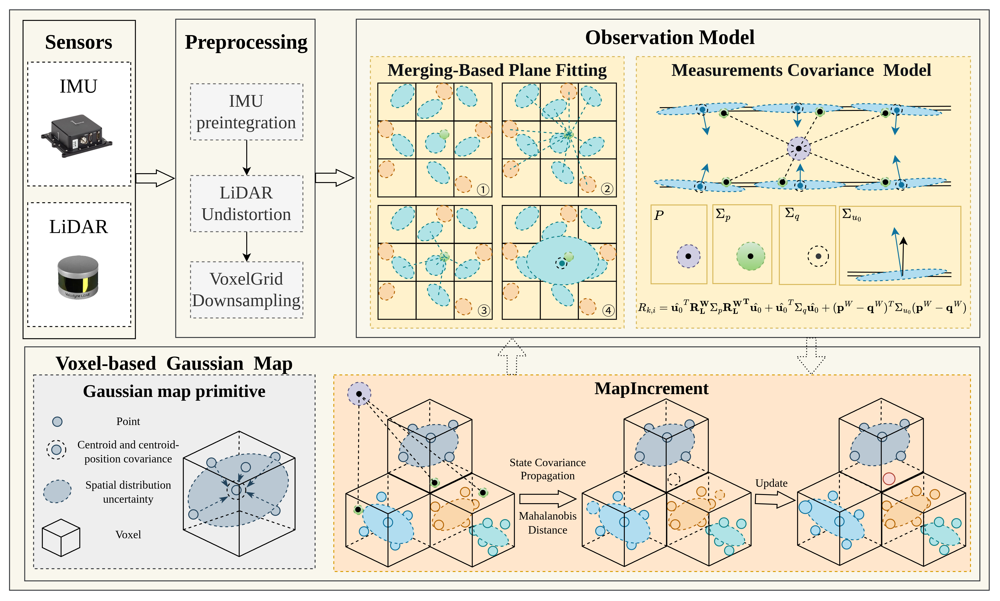
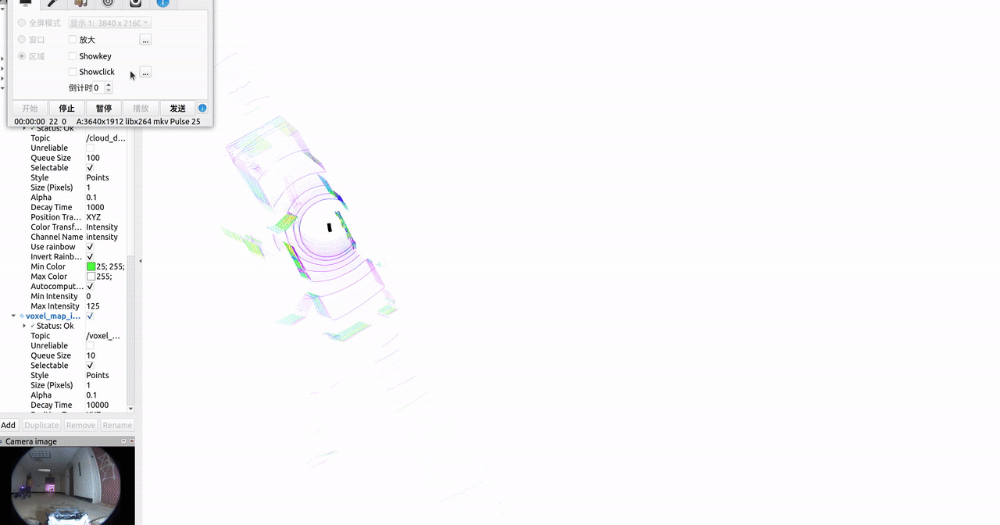
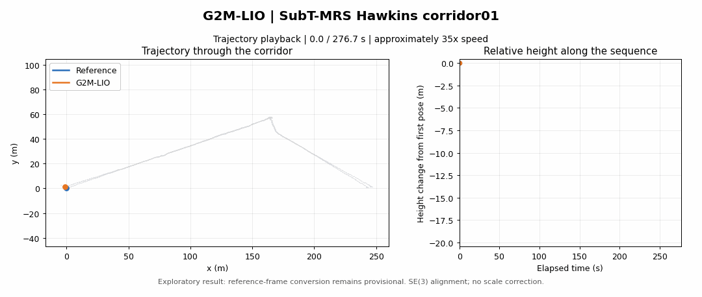
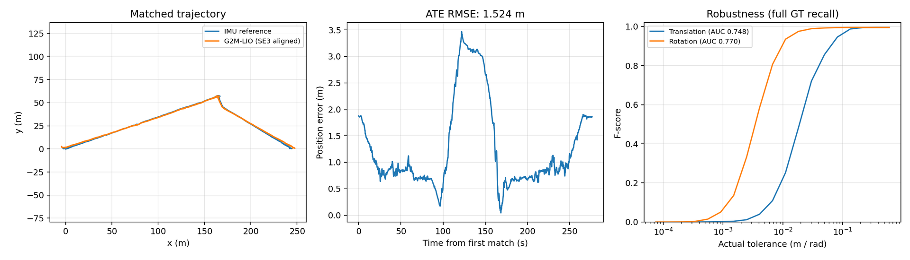
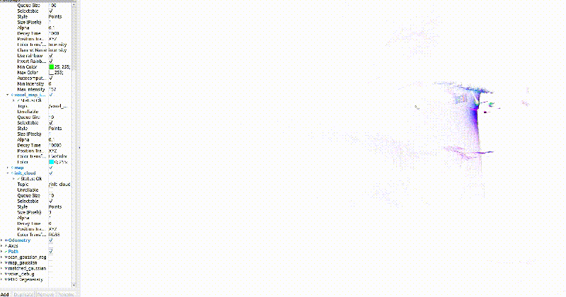
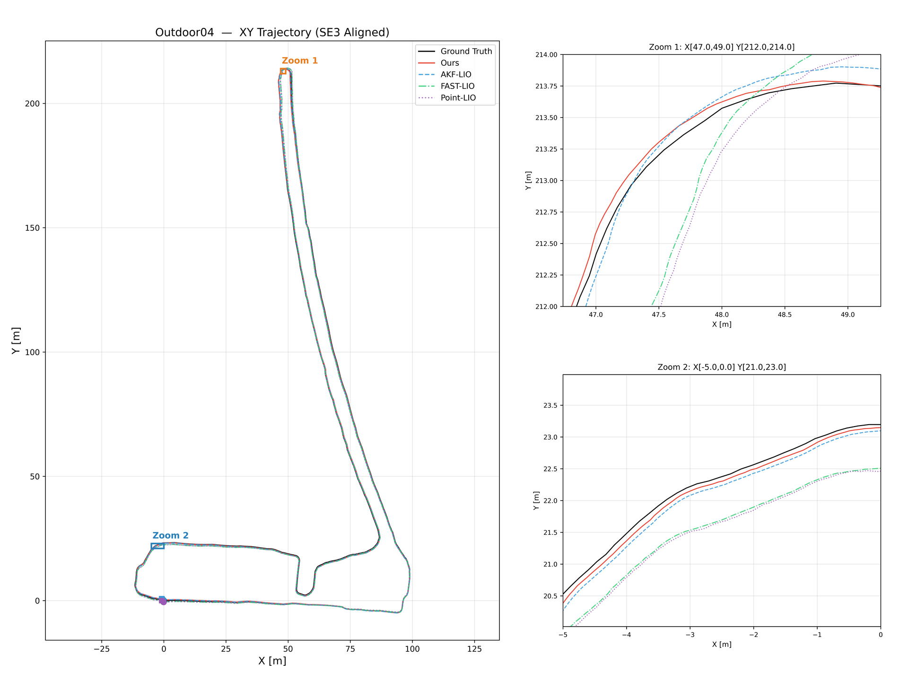
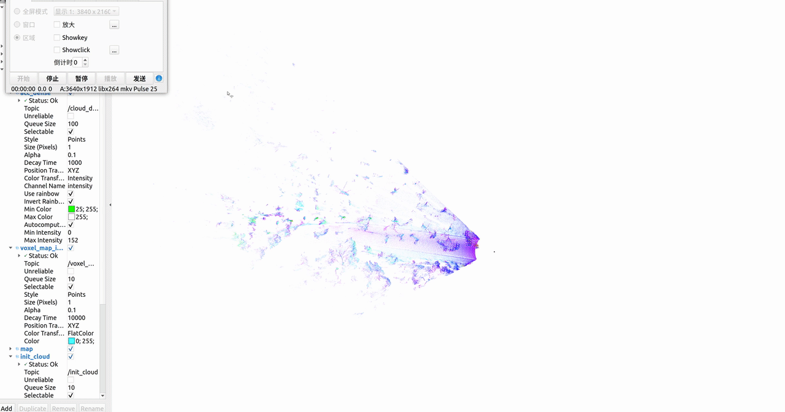
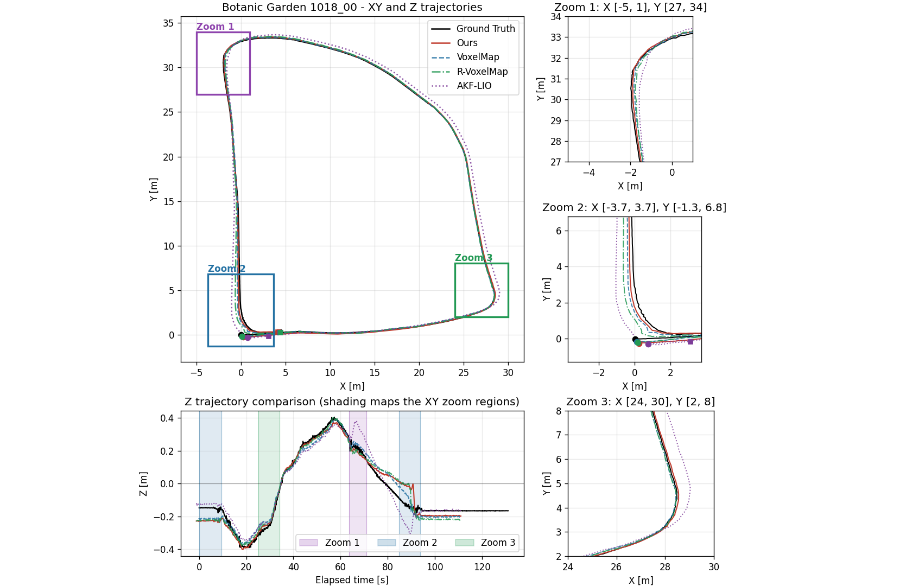

<h1 align="center">G2M-LIO: LiDAR-Inertial Odometry Based on Gaussian Voxel Map Merging and Modeling Strategy</h1>

  <a href="#overview">Overview</a> ·
  <a href="#install">Install</a> ·
  <a href="#run">Results &amp; Tools</a> ·
  <a href="#acknowledgement">Acknowledgement</a> ·
  <a href="#license">License</a>

## Overview

G2M-LIO is a LiDAR-inertial odometry research project built on [AKF-LIO](https://github.com/xpxie/AKF-LIO). It explores Gaussian voxel maps, focusing on strategies for merging and modeling Gaussian primitives.

  

> **Release plan** — Results, analysis tools, four configuration files, and their launch/RViz files are available here. Core source will be released after its comments and main components have been reviewed and the paper is formally accepted.

## Prerequisites

### Odometry system

The development environment is **Ubuntu 20.04 · ROS Noetic · C++17**.

| Component | Requirement |
| :--- | :--- |
| Build tools | CMake 3.5+, catkin, and a C++17 compiler |
| C++ libraries | Eigen3, PCL 1.8+, OpenCV, yaml-cpp, glog, and gflags |
| ROS packages | roscpp, rospy, geometry_msgs, nav_msgs, sensor_msgs, std_msgs, tf, pcl_ros, eigen_conversions, cv_bridge, and message generation/runtime |
| Playback & visualization | rosbag, RViz; nodelet and velodyne_pointcloud for Hawkins packet decoding |
| Livox messages | The core package includes the livox_ros_driver message definitions; live acquisition requires a compatible sensor driver |

With **ROS Noetic already installed and configured**, install the remaining dependencies:

~~~bash
sudo apt update
sudo apt install -y \
  build-essential cmake git python3-pip python3-venv \
  libeigen3-dev libpcl-dev libopencv-dev libyaml-cpp-dev \
  libgoogle-glog-dev libgflags-dev \
  ros-noetic-catkin ros-noetic-roscpp ros-noetic-rospy \
  ros-noetic-geometry-msgs ros-noetic-nav-msgs \
  ros-noetic-sensor-msgs ros-noetic-std-msgs ros-noetic-tf \
  ros-noetic-pcl-ros ros-noetic-eigen-conversions ros-noetic-cv-bridge \
  ros-noetic-message-generation ros-noetic-message-runtime \
  ros-noetic-rosbag ros-noetic-rviz \
  ros-noetic-nodelet ros-noetic-velodyne-pointcloud
~~~

### Analysis tools

**Python 3.8+**, **NumPy ≥ 1.24.4**, **SciPy ≥ 1.10.1**, and **Matplotlib ≥ 3.7.5** are required. The tools were checked locally with Python 3.8.10 and those library versions. ROS is not required for offline analysis.

## Install

### Analysis tools · available now

From the repository root, create an isolated Python environment and install the dependencies:

~~~bash
python3 -m venv .venv
source .venv/bin/activate
python3 -m pip install \
  'numpy>=1.24.4' 'scipy>=1.10.1' 'matplotlib>=3.7.5'
~~~

Activate this environment again in each new analysis terminal with `source .venv/bin/activate`.

### Odometry system · core source required

<!-- ~~~bash
source /opt/ros/noetic/setup.bash
mkdir -p ~/g2m_ws/src
cp -a /path/to/core_release/src/G2M_LIO ~/g2m_ws/src/
cp -a config launch rviz_cfg ~/g2m_ws/src/G2M_LIO/
cd ~/g2m_ws
catkin_make -DCMAKE_BUILD_TYPE=Release
source devel/setup.bash
~~~ -->

## Run

### Odometry commands

In each ROS terminal, load the environment:

~~~bash
source /opt/ros/noetic/setup.bash
source ~/g2m_ws/devel/setup.bash
~~~

Check the YAML topics, timestamp units, LiDAR type, and extrinsic calibration against the recording first. These launch files do not enable simulated time except for SubT-MRS Hawkins.

The launch and RViz files in `launch/` and `rviz_cfg/` match the four public configurations. They do not include the G2M-LIO ROS node or its build files.

**Livox Avia — `avia.yaml` + `avia.launch`**

~~~bash
# Terminal 1
roslaunch g2m_lio avia.launch rviz:=true

# Terminal 2
rosbag play /path/to/avia_sequence.bag
~~~

**Livox Mid-360 — `mid360.yaml` + `mid360.launch`**

~~~bash
# Terminal 1
roslaunch g2m_lio mid360.launch rviz:=true

# Terminal 2
rosbag play /path/to/mid360_sequence.bag
~~~

**SubT-MRS Hawkins — `subt_mrs_hawkins.yaml` + `subt_mrs_hawkins.launch`**

~~~bash
# Terminal 1
roslaunch g2m_lio subt_mrs_hawkins.launch rviz:=true play_bag:=false use_sim_time:=false

# Terminal 2
rosbag play /path/to/raw_data_core_2023-07-25-03-01-44.bag -s 3
~~~

This example plays the **original SubT-MRS corridor bag**. The launch decodes VLP-16 packets from `/velodyne_packets` and reads IMU data from `/imu/data`. The start offset is adjustable; the local raw-bag playback command used 3 s.

**NTU VIRAL — `ntuviral.yaml` + `ntuviral.launch`**

~~~bash
# Terminal 1
roslaunch g2m_lio ntuviral.launch rviz:=true

# Terminal 2
rosbag play /path/to/ntuviral_sequence.bag
~~~

### SubT-MRS · Hawkins Long Corridor

  
   
  Long_Corridor_RC · 10×

  
   
  Trajectory

  

SE(3) alignment without scale correction; maximum timestamp difference: **0.02 s**.

### M3DGR · Outdoor04

  
   
  Outdoor04 · 38×

  
   
  SE(3)-aligned XY trajectories with local zooms

### Botanic Garden

<table>
  <tr>
    <th align="center">1018_00 · 10×</th>
    <th align="center">1005_01 · 25×</th>
  </tr>
  <tr>
    <td width="50%"></td>
    <td width="50%"></td>
  </tr>
</table>

  
   
  Trajectory comparison

### Analysis commands

Run from the repository root with the analysis environment activated.

**Trajectory comparison** — input rows: `t x y z qx qy qz qw`, with time in seconds and position in meters. The first trajectory is the reference; estimates are SE(3)-aligned without scale correction.

~~~bash
python3 scripts/plot_traj_xy.py \
  --traj-dir /path/to/trajectories \
  --trajectory gt.txt 'Ground truth' \
  --trajectory ours.txt 'G2M-LIO' \
  --auto-zoom --z-comparison \
  --output results/trajectory_comparison.png
~~~

**Consistency analysis** — requires a G2M-LIO log and matching reference poses:

~~~bash
python3 scripts/analyze_consistency.py \
  --log /path/to/consistency.csv \
  --gt /path/to/ground_truth.txt --gt-format tum \
  --align first --output-prefix results/consistency

python3 scripts/plot_nees_trajectories.py \
  --analysis results/consistency.csv 'G2M-LIO' \
  --color-scale absolute --output results/trajectory_nees.png
~~~

The log header must contain `timestamp, x, y, z, qx, qy, qz, qw, nis, nis_dof` and the 36 covariance fields `P00`–`P55`, ordered as position followed by local rotation error. Reference poses must use compatible frames and time units. For NTU VIRAL CSV ground truth, select `--gt-format ntuviral`: it skips one header row and reads column 3 as nanosecond timestamps, columns 4–6 as position, and columns 7–10 as `qx qy qz qw`.

### Configuration references

| Sensor / dataset | Configuration | Launch | RViz |
| :--- | :--- | :--- | :--- |
| Livox Avia / [Botanic Garden](https://github.com/robot-pesg/BotanicGarden) | `config/avia.yaml` | `launch/avia.launch` | `rviz_cfg/loam.rviz` |
| Livox Mid-360 / [M3DGR](https://github.com/SJTU-ViSYS/M3DGR) | `config/mid360.yaml` | `launch/mid360.launch` | `rviz_cfg/loam.rviz` |
| VLP-16 / [SubT-MRS](https://superodometry.com/datasets) | `config/subt_mrs_hawkins.yaml` | `launch/subt_mrs_hawkins.launch` | `rviz_cfg/subt_mrs_hawkins.rviz` |
| Ouster / [NTU VIRAL](https://ntu-aris.github.io/ntu_viral_dataset/) | `config/ntuviral.yaml` | `launch/ntuviral.launch` | `rviz_cfg/loam.rviz` |

## Acknowledgement

We offer our heartfelt thanks and deepest respect to the authors and maintainers of the following projects. Their outstanding research, thoughtful algorithm design, and generous release of well-crafted implementations have been an invaluable source of knowledge and inspiration. We are sincerely grateful for the time, care, and expertise they have shared with the research community:

[AKF-LIO](https://github.com/xpxie/AKF-LIO) · [FAST-LIO2](https://github.com/hku-mars/FAST_LIO) · [Point-LIO](https://github.com/hku-mars/Point-LIO) · [VoxelMap](https://github.com/hku-mars/VoxelMap) · [R-VoxelMap](https://github.com/NKU-MobFly-Robotics/R-VoxelMap)

We extend our deepest appreciation to the teams behind the following datasets. Their extensive work in field data collection, sensor calibration, curation, and public distribution makes rigorous evaluation in challenging real-world environments possible. We gratefully acknowledge this lasting contribution to the community:

[M3DGR](https://github.com/SJTU-ViSYS/M3DGR) · [NTU VIRAL](https://ntu-aris.github.io/ntu_viral_dataset/) · [Botanic Garden](https://github.com/robot-pesg/BotanicGarden) · [SubT-MRS](https://superodometry.com/datasets)

## Known Issues

I welcome discussions about the algorithm, but my knowledge is limited, so it may take me considerable time to offer an explanation, and that explanation may not be rigorous. I will list confirmed unresolved issues here; some may also point to directions for my future research.

## LICENSE

Software: **GPL-2.0-only** — see [LICENSE](LICENSE). Datasets and third-party media retain their respective terms.
